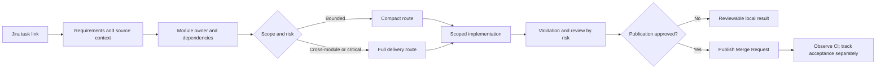
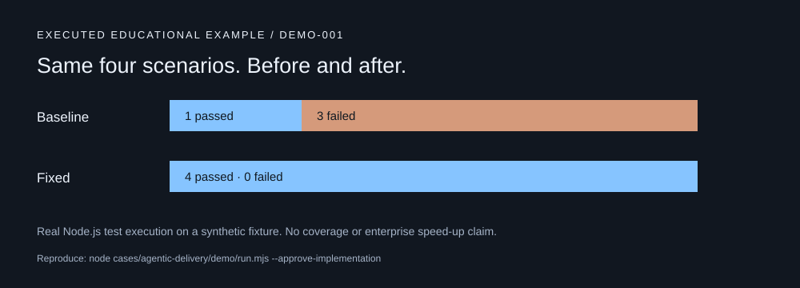

# Jira → Merge Request

### Enterprise agentic development, designed by Andrey Karaban

**A year of building automation that connects a task link to a validated change and a Merge Request ready for publication.**

[Read the visual case study](https://nabarakdev.github.io/case-agentic.html?lang=en) · [Русская версия](README.ru.md) · [Run the demonstration](demo/README.md) · [Architecture](docs/architecture.md)

The engineering work is the system around the agents: the requirements they receive, the architectural boundaries they respect, the context they hand off, the checks they execute and the approvals they must preserve. I designed and configured that system for three multi-module mobile workspaces.

## The workflow



An engineer can inspect or intervene at every stage. Existing authorisation remains valid within its scope; a new external effect requires the corresponding approval. A Jira link supplies task context, while publication and merge retain their own boundaries.

## What I designed

- **Requirements and working agreements:** source authority, task routing, approval checkpoints and completion criteria.
- **Architectural context:** module ownership, dependency direction, active sources and client-server contracts.
- **Agent responsibilities:** bounded implementation, specialist analysis, independent review where required and revision-bound handoffs.
- **Tool integration:** Codex, `AGENTS.md`, reusable Skills, MCP services and software exposing a CLI.
- **Delivery:** meaningful validation, narrow diffs, the correct repository and target branch, related Merge Requests and CI visibility.
- **Continuous improvement:** reviewing outcomes, refining boundaries and correcting failure patterns across projects.

The foundations come from my work since 2014 in iOS engineering, mobile architecture and technical leadership. This case focuses on the past year of enterprise agentic systems and development automation.

## Layers of the system

| Layer | Responsibility | Result |
| --- | --- | --- |
| Sources | Tracker, specifications, API contracts, designs and repository facts | A task grounded in confirmed context |
| Orchestration | Rules, risk routing, module map and agent assignments | A bounded implementation plan |
| Execution | One active writer per checkout; relevant specialist analysis | A scoped code change |
| Validation | Tests, static analysis, diff review and runtime checks by need | Results tied to a revision |
| Publication | Repository and branch checks, approval and MR preparation | A reviewable MR and observed CI state |

## Demonstration you can run

A deterministic, self-contained example reproduces a search race condition, fixes the owning package and prepares real delivery artifacts. It uses synthetic data, no corporate code or credentials.

```sh
# Intake only: stops before implementation.
node cases/agentic-delivery/demo/run.mjs

# Explicitly allow the local educational implementation.
node cases/agentic-delivery/demo/run.mjs --approve-implementation
```

The first command resolves the fixture task and its owner without changing source files. The second executes a broken baseline, applies the bounded fix, runs the same tests and writes `change.diff`, `validation.json`, raw test results and `merge-request.md` under the ignored `.demo-output/` directory.



In the executed example, the baseline produced **1 passing / 3 failing tests**, and the fixed version produced **4 passing / 0 failing tests**. These are regression checks on a synthetic fixture, not business impact, a coverage metric or an estimate of enterprise success rates.

The public runner automates the local delivery stages deterministically. It does not call an AI model, connect to Jira/GitLab, run independent agents or publish an MR. [The agent-session guide](demo/agent-session.md) explains how to use the same fixture in an actual agent session. The interactive website is a process walkthrough, not a recording of a corporate run.

## Reading the evidence

- Installed instructions show how work is configured; execution records show what actually ran.
- Self-check is labelled separately from independent review.
- Local tests, hosted CI, mobile runtime, merge and product acceptance are reported separately.
- No speed-up, cost reduction, “100% autonomy” or universal success rate is claimed without measurements.
- Corporate source code, task identifiers, internal addresses, access settings and chat history are not part of this repository.

[Architecture and handoffs](docs/architecture.md) · [Measurement plan](docs/measurement-plan.md) · [Demo details](demo/README.md)
