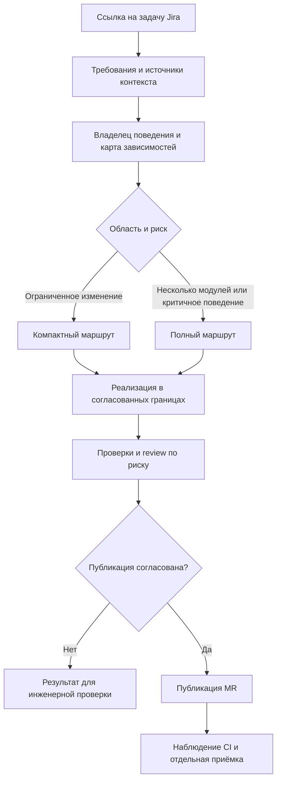
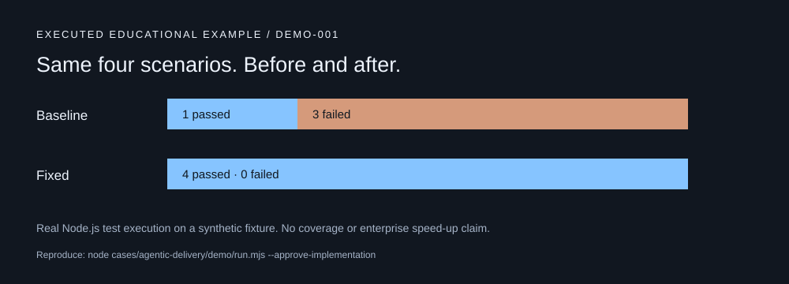

# Jira → Merge Request

### Корпоративная агентская разработка — Андрей Карабань

**Последний год создаю агентские системы, которые проводят задачу от ссылки в Jira до проверенного изменения и готового к публикации Merge Request.**

[Визуальный разбор кейса](https://nabarakdev.github.io/case-agentic.html?lang=ru) · [English](README.md) · [Запуск демонстрации](demo/README.md)

Моя работа — архитектура инженерного процесса: требования, общие правила, границы модулей и полномочий, роли агентов, передача контекста, проверки и согласования. Такой процесс я спроектировал и настроил для трёх рабочих пространств многомодульных мобильных продуктов.

## От задачи к поставке



Инженер может проверить или остановить процесс на любом этапе. Уже выданные разрешения сохраняются в своих границах; новые внешние действия требуют соответствующего согласования. Публикация MR, его слияние и выпуск продукта остаются отдельными решениями.

## Мой вклад

| Направление | Что выстроено |
| --- | --- |
| Требования | Источники истины, критерии готовности, общие правила и разрешения |
| Архитектура | Границы модулей, направления зависимостей, источники пакетов и клиент-серверные контракты |
| Агентская работа | Роли, ограниченный исполнитель, анализ и независимое ревью по риску |
| Передача контекста | Задача, ограничения, точная ревизия, результаты и оставшиеся проверки |
| Инструменты | Codex, AGENTS.md, Skills, MCP-сервисы и интеграция ПО с CLI |
| Поставка | Проверяемый diff, правильный проект и ветки, связанные MR и наблюдаемый CI |

Постоянно проверял результаты, уточнял связи и границы, донастраивал handoff и совершенствовал процесс по мере применения. Основа — опыт разработки с 2014 года, технического руководства командами и запуска мобильных продуктов.

## Исполняемый пример

```sh
node cases/agentic-delivery/demo/run.mjs
node cases/agentic-delivery/demo/run.mjs --approve-implementation
```

Первая команда читает учебную задачу и останавливается до реализации. Вторая воспроизводит ошибку устаревшего ответа поиска, применяет ограниченное исправление и запускает реальные тесты. Результат: diff, журнал проверок и описание MR в локальном каталоге `.demo-output/`.



В выполненном примере до исправления прошёл 1 тест и упали 3, после исправления прошли все 4. Это результаты синтетического регрессионного сценария, а не оценка производительности команды или бизнес-эффекта.

Публичный runner детерминированно демонстрирует локальные этапы. Он не вызывает модель ИИ, не подключается к Jira/GitLab, не запускает независимых агентов и не публикует MR. Для настоящей агентской сессии подготовлен [отдельный сценарий](demo/agent-session.md). Интерактивная схема на сайте объясняет процесс и не выдаётся за запись корпоративного запуска.

## Доказательства и границы

В документации разделены настройка и реальное выполнение, самопроверка и независимое ревью, локальные тесты и CI, проверка приложения и приёмка. Корпоративные исходники, ключи задач, внутренние адреса, конфиги доступа и история чатов не публикуются. Ускорение в процентах и полная автономность без замеров не заявляются.

[Архитектура процесса](docs/architecture.md) · [План измерений](docs/measurement-plan.md) · [Демонстрация](demo/README.md)
