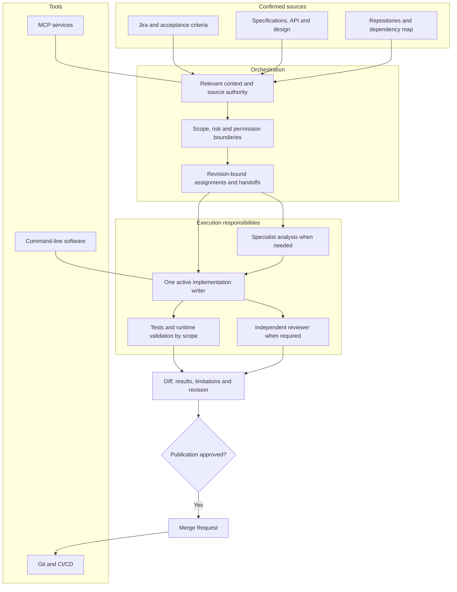
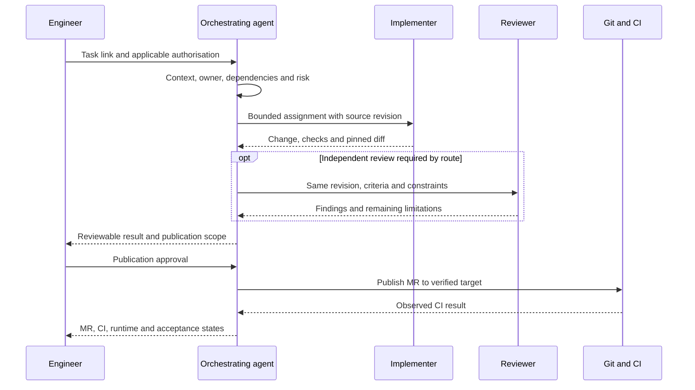
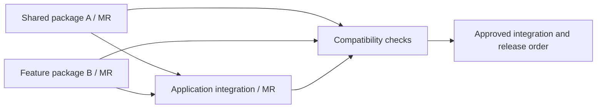

# Architecture & context handoffs

This is the generalised architecture of the configured engineering process. Boxes represent responsibilities and integration boundaries, not a claim that a bespoke agent runtime or hard enforcement mechanism was built.

## Compact and full routes

A bounded, reversible change with a confirmed owner can use a compact route: gather the necessary context, implement within scope and perform proportionate checks. Cross-repository behaviour, changed API contracts, authentication, signing, payment execution or unresolved product behaviour require the fuller delivery route and the applicable independent review.

The route changes the depth of analysis and evidence, not the requirement to perform meaningful validation. Existing required project suites and migration cycles remain mandatory.

## The handoff contract

| Field | Purpose |
| --- | --- |
| Task and acceptance criteria | Establish expected behaviour |
| Owning module and permitted files | Limit implementation scope |
| Source and dependency revisions | Make the assignment reproducible |
| Decisions and unresolved questions | Preserve source authority |
| Checks and actual results | Distinguish execution from intention |
| Review findings and limitations | Keep remaining work visible |
| Publication target and approval | Bound external effects |

## Multiple repositories

Repository identity, active dependency sources, source and target branches and integration order are checked independently. A passing package test does not prove that the consuming application is ready.

## Enforcement boundary

Markdown instructions guide agent behaviour; their existence does not prove technical enforcement. Server branch protection, credentials and runtime safeguards remain separate controls. A repeated pass by the same agent is not independent review.

## Platform references

The configured process builds on platform capabilities documented by OpenAI: [AGENTS.md instructions](https://learn.chatgpt.com/docs/agent-configuration/agents-md) and [Skills](https://learn.chatgpt.com/docs/build-skills). The project-specific architecture, working rules, boundaries and delivery process are my engineering contribution.
